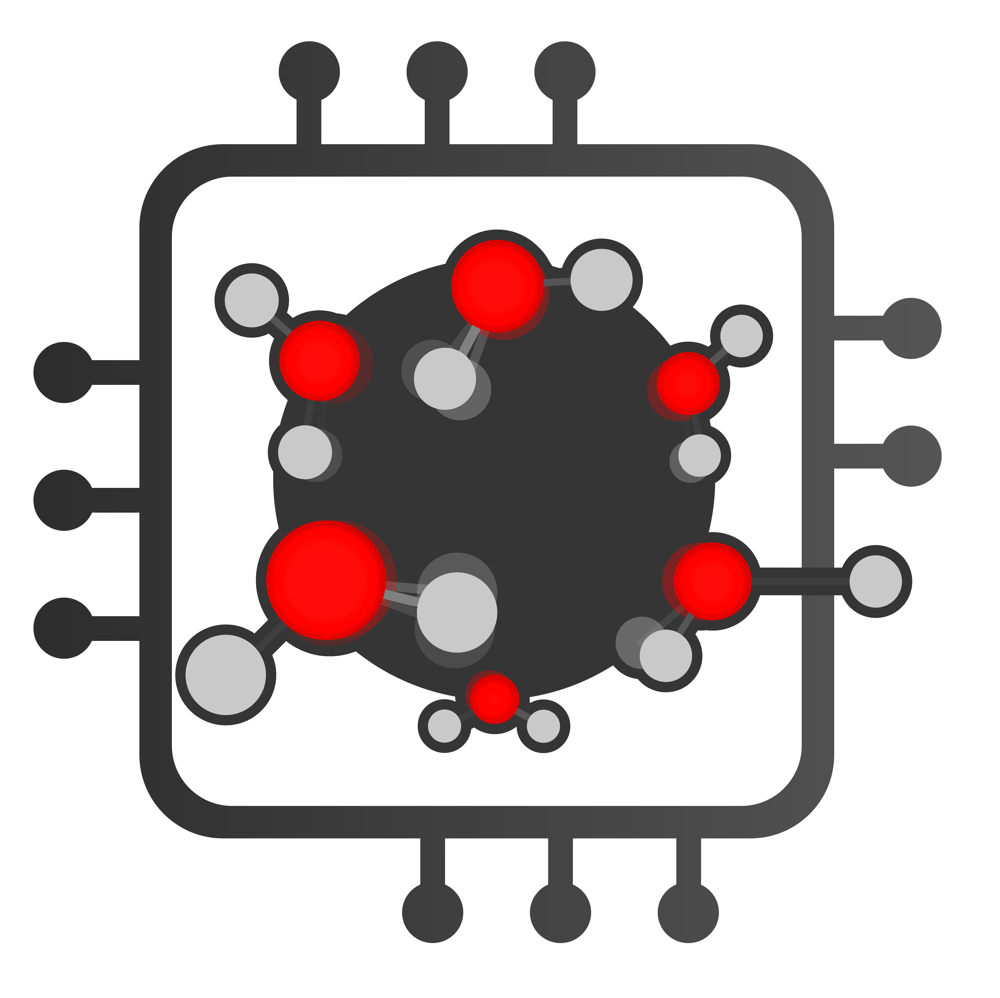

waterEntropy
============

| Category       | Badges |
|----------------|--------|
| **Build**      |   |
| **Documentation** |   |
| **PyPI**       |      |
| **Quality**    |  |

waterEntropy is a Python package for calculating interfacial water entropy from molecular dynamics simulations.

    
    

See [waterEntropy Documentation](https://waterentropy.readthedocs.io/en/latest/) for more information.
